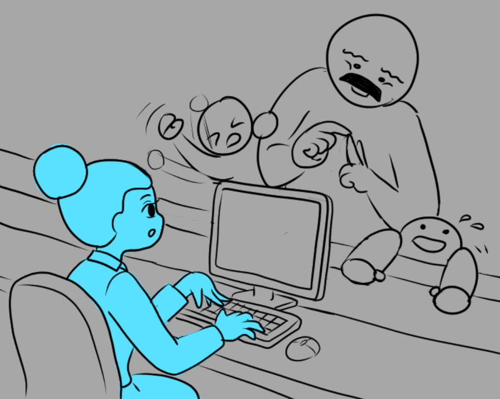
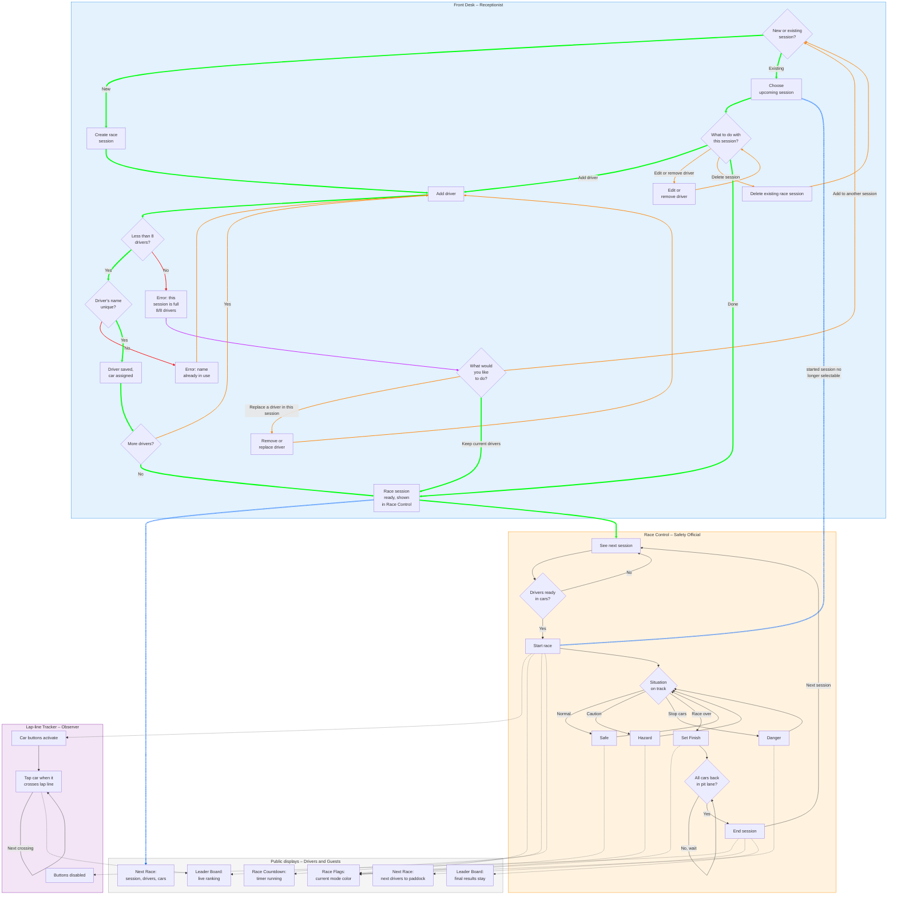

# Racetrack Info-Screens – Requirements List

## Interfaces overview

| Interface | Persona | Route |
|---|---|---|
| Front Desk | Receptionist | `/front-desk` |
| Race Control | Safety Official | `/race-control` |
| Lap-line Tracker | Lap-line Observer | `/lap-line-tracker` |
| Leader Board | Guest | `/leader-board` |
| Next Race | Race Driver | `/next-race` |
| Race Countdown | Race Driver | `/race-countdown` |
| Race Flags | Race Driver | `/race-flags` |

---

### General requirements

- [ ] **GEN-01** All interfaces update in real time without polling (e.g. Socket.IO).
- [ ] **GEN-02** Employee interfaces (Front Desk, Race Control, Lap-line Tracker) require an access key before use.
- [ ] **GEN-03** Access keys are set via environment variables; the server must not start if they are missing.
- [ ] **GEN-04** An incorrect access key gets a 500 ms delayed response before the user can try again.
- [ ] **GEN-05** A race lasts 10 minutes in normal mode, but in development mode the race timer is 1 minute, to make testing faster.
- [ ] **GEN-06** Public displays (Guest and Race Driver interfaces) need no login and have a fullscreen button.

---

### Front Desk
**Persona:** Receptionist · **Route:** `/front-desk`

- [ ] **FD-01** View a list of upcoming race sessions.
- [ ] **FD-02** Add and remove race sessions (Starting times are not editable -> All the sessions go to a list and Safety Official just presses "start").
- [ ] **FD-03** Add, edit and remove drivers in a session.
- [ ] **FD-04** Driver names must be unique within a session.
- [ ] **FD-05** Maximum number of drivers per session (likely 8).
- [ ] **FD-06** Drivers are assigned cars.
- [ ] **FD-07** A session disappears from the list once it starts.

### Race Control
**Persona:** Safety Official · **Route:** `/race-control`

- [ ] **RC-01** View the next race session.
- [ ] **RC-02** Start the race, which sets the mode to Safe and starts the timer.
- [ ] **RC-03** Change race mode: Safe / Hazard / Danger / Finish.
- [ ] **RC-04** Finish mode is final and cannot be undone.
- [ ] **RC-05** End the session once cars have returned to the pit lane, after which the next session is shown.
- [ ] **RC-06** Designed for mobile use.

### Lap-line Tracker
**Persona:** Lap-line Observer · **Route:** `/lap-line-tracker`

- [ ] **LT-01** One large button per car.
- [ ] **LT-02** Pressing a button records the car crossing the lap line, used to calculate lap times.
- [ ] **LT-03** Designed for tablet use with easy-to-hit buttons.
- [ ] **LT-04** Buttons are disabled when the session ends.

### Leader Board
**Persona:** Guest · **Route:** `/leader-board`

- [ ] **LB-01** Drivers are ordered by fastest lap time.
- [ ] **LB-02** Shows car number, driver name, fastest lap and current lap.
- [ ] **LB-03** Shows remaining race time.
- [ ] **LB-04** Shows the current flag/mode.
- [ ] **LB-05** Keeps showing the previous race's results until the next race starts.
- [ ] **LB-06** Fullscreen button.

### Next Race
**Persona:** Race Driver · **Route:** `/next-race`

- [ ] **NR-01** Shows drivers and assigned cars for the upcoming session.
- [ ] **NR-02** After a race ends, shows a message telling the next session's drivers to proceed to the paddock.
- [ ] **NR-03** Fullscreen button.

### Race Countdown
**Persona:** Race Driver · **Route:** `/race-countdown`

- [ ] **CD-01** Shows remaining race time.
- [ ] **CD-02** Fullscreen button.

### Race Flags
**Persona:** Race Driver · **Route:** `/race-flags`

- [ ] **RF-01** The full screen shows the color matching the current mode:
  - Safe = green
  - Hazard = yellow
  - Danger = red
  - Finish = chequered
- [ ] **RF-02** Fullscreen button.

### User personas

#### Employees

<table>
<tr>
<td width="calc(100% / 3)" valign="top">

</td>
<td width="calc(100% / 3)" valign="top">

</td>
<td width="calc(100% / 3)" valign="top">

</td>
</tr>
<tr>
<td valign="top">

#### Receptionist – "Liisa"

> "There's a race coming and guests are asking for directions to the spectator area, I need to pay attention to two things at once."

**Age:** 24 · **Device:** Desktop at reception · **Login:** Yes

**Background:** 24, works part-time at the racetrack reception alongside her studies. Comfortable with computers but not technical.
 
**Context:** Works at a busy front desk, often talking to customers while typing. Interruptions are constant, especially on weekends.
 
**Goals**
- Register drivers into upcoming sessions quickly
- Fix mistakes (typos, swapped drivers) without starting over
- Know at a glance which sessions are full and which still have space

**Frustrations**
- Unclear error messages that don't say what to do next
- Losing typed information after an error
- Not knowing whether a session has already started

</td>
<td valign="top">

#### Receptionist – "Maya"

> "There's a queue at the desk and someone wants to change their friend's name."

**Age:** 24 · **Device:** Desktop at reception · **Login:** Yes

</td>
<td valign="top">

#### Receptionist – "Maya"

> "There's a queue at the desk and someone wants to change their friend's name."

**Age:** 24 · **Device:** Desktop at reception · **Login:** Yes

</td>
</tr>
</table>

## 1. End-to-end flow across interfaces

**Legend**
- Solid arrow `-->` = the person's next step
- Dotted arrow `-.->` = real-time update sent to another interface `[GEN-01]`
- 🟩 Green arrow shows the desired path
- 🟥 Red shows an error in the selection
- 🟪 Purple shows an optional path to goal
- 🟧 Orange goes back steps
- 🟦 Blue illustrates the real-time updates

