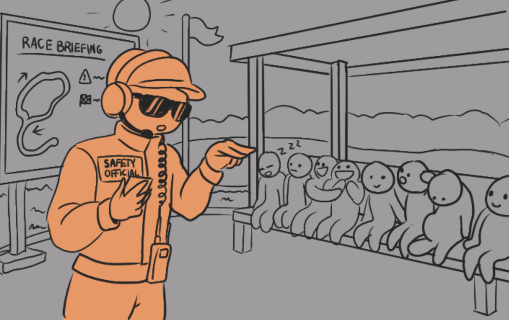
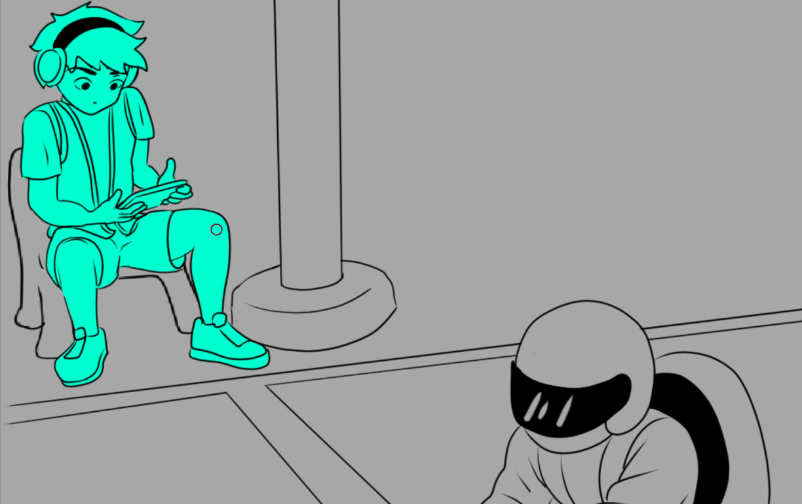
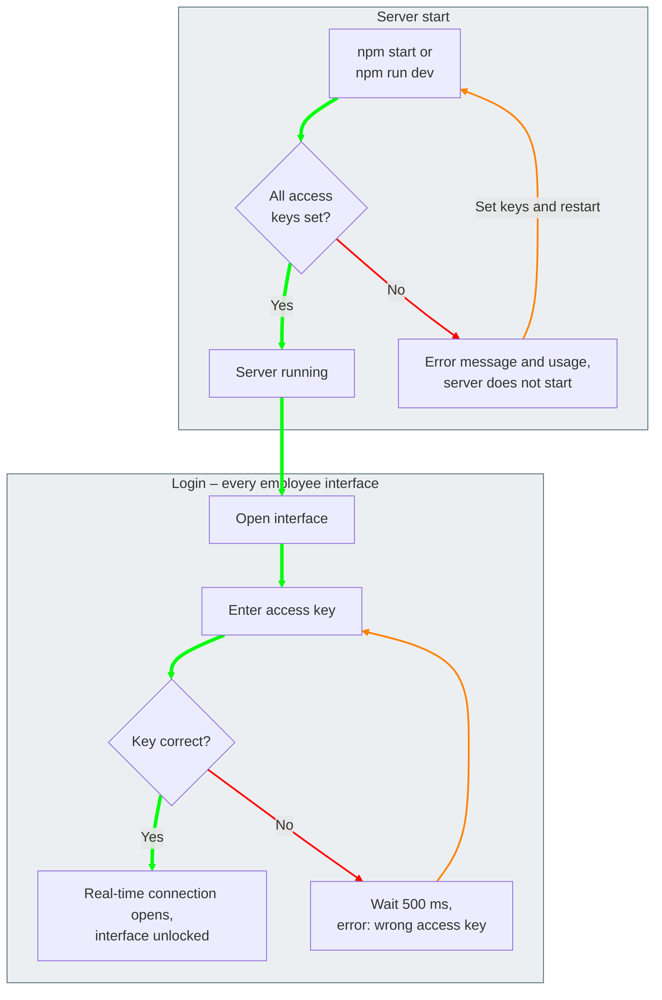
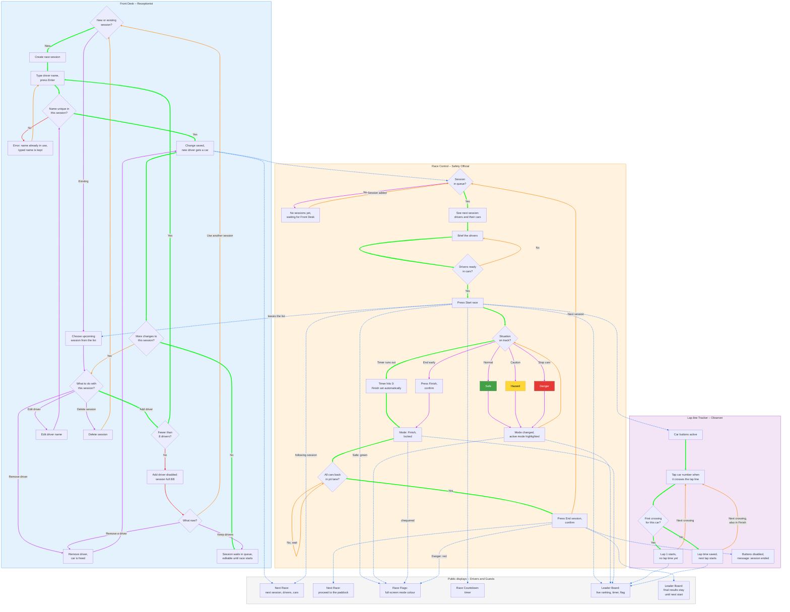

# Racetrack Info-Screens – Requirements List

## Interfaces overview

| Interface | Persona | Route |
|---|---|---|
| Front Desk | Receptionist | `/front-desk` |
| Race Control | Safety Official | `/race-control` |
| Lap-line Tracker | Lap-line Observer | `/lap-line-tracker` |
| Leader Board | Guest | `/leader-board` |
| Next Race | Race Driver | `/next-race` |
| Race Countdown | Race Driver | `/race-countdown` |
| Race Flags | Race Driver | `/race-flags` |

---

### General requirements

- [ ] **GEN-01** All interfaces update in real time with Socket.IO. No polling.
- [ ] **GEN-02** Interfaces may make API calls only to establish the real-time connection. All data is sent as real-time messages.
- [ ] **GEN-03** Each employee interface (Front Desk, Race Control, Lap-line Tracker) has its own access key, so a key can be given only to people who are qualified for that role.
- [ ] **GEN-04** The access key is asked before the Socket.IO connection is opened.
- [ ] **GEN-05** Access keys are set as environment variables before the server starts.
- [ ] **GEN-06** If the access key is wrong, the server waits 500 ms before responding. The interface shows an error message and asks for the key again.
- [ ] **GEN-07** If any access key is missing, the server does not start. It prints an error message and usage instructions.
- [ ] **GEN-08** `npm start` runs the server with a 10-minute race timer. `npm run dev` uses a 1-minute timer to make testing faster.
- [ ] **GEN-09** Interfaces are reachable from devices on different networks at the same time (e.g. via ngrok), and each interface has a first-level route (e.g. `/leader-board`).
- [ ] **GEN-10** The server is built with Node.js.
- [ ] **GEN-11** Data does not need to survive a server restart (MVP). Past race sessions are erased.
- [ ] **GEN-12** Public displays (Guest and Race Driver interfaces) need no login and have a fullscreen button.
- [ ] **GEN-13** `README.md` at the project root: how to start the server (including environment variables) and a user guide with screenshots.

---

### Front Desk
**Persona:** Receptionist · **Route:** `/front-desk`

- [ ] **FD-01** View a list of upcoming race sessions.
- [ ] **FD-02** Add and remove race sessions. Sessions have no start times: they wait in a queue, and the Safety Official starts the next one.
- [ ] **FD-03** Add, edit and remove drivers in a session.
- [ ] **FD-04** Driver names must be unique within a session (also when editing a name).
- [ ] **FD-05** A session has at most 8 drivers.
- [ ] **FD-06** A car is assigned automatically when a driver is added.
- [ ] **FD-07** A session disappears from the list once its race starts.
- [ ] **FD-08** Pressing Enter adds the driver. *(design choice)*
- [ ] **FD-09** Each session shows its capacity, e.g. 6/8, colour-coded. *(design choice)*
- [ ] **FD-10** An error never clears the name that was typed. *(design choice)*
- [ ] **FD-11** "Add driver" is disabled when the session is full. *(design choice)*
- [ ] **FD-12** The session that is next in line shows a soft "final check" banner. *(design choice)*

### Race Control
**Persona:** Safety Official · **Route:** `/race-control`

- [ ] **RC-01** View the next race session: drivers and their cars, so the Safety Official can brief them.
- [ ] **RC-02** Start the race. This sets the mode to Safe and starts the timer, switches the Leader Board to the current race and the Next Race screen to the following session.
- [ ] **RC-03** Change the race mode: Safe / Hazard / Danger / Finish.
- [ ] **RC-04** Finish is final and cannot be changed to any other mode.
- [ ] **RC-05** End the session once all cars are back in the pit lane. The next session is then shown.
- [ ] **RC-06** Designed for phone use.
- [ ] **RC-07** When the timer reaches zero, the mode changes to Finish automatically.
- [ ] **RC-08** When the session is ended, the mode changes to Danger (nobody drives while employees move on the track).
- [ ] **RC-09** Before the start, only the "Start race" button is shown. After the start, the four mode buttons appear.
- [ ] **RC-10** "End session" is only possible when the mode is Finish.
- [ ] **RC-11** Finish and End session ask for confirmation. Danger never does: in an emergency every second counts. *(design choice)*
- [ ] **RC-12** The current mode and the remaining time are always visible. *(design choice)*

### Lap-line Tracker
**Persona:** Lap-line Observer · **Route:** `/lap-line-tracker`

- [ ] **LT-01** One large button per car.
- [ ] **LT-02** Pressing a button records that the car crossed the lap line. Lap times are calculated from these presses.
- [ ] **LT-03** Designed for tablet use with large, easy-to-hit buttons.
- [ ] **LT-04** Buttons still work in Finish mode (cars still cross the line on their way to the pit lane).
- [ ] **LT-05** Buttons disappear or are disabled when the session is ended.
- [ ] **LT-06** Works in both landscape and portrait.
- [ ] **LT-07** A car's first crossing of the lap line starts lap 1 and records no lap time yet. Every following crossing completes a lap, records its time and starts the next lap.
- [ ] **LT-08** A button shows only the car number.
- [ ] **LT-09** When the session is ended, a message says so (e.g. "Session ended – lap timing is closed").

### Leader Board
**Persona:** Guest · **Route:** `/leader-board`

- [ ] **LB-01** Drivers are ordered by fastest lap time.
- [ ] **LB-02** Shows car number, driver name, fastest lap and current lap.
- [ ] **LB-03** Shows the remaining race time.
- [ ] **LB-04** Shows the current flag/mode.
- [ ] **LB-05** Keeps showing the previous race's results until the next race starts.
- [ ] **LB-06** Fullscreen button.

### Next Race
**Persona:** Race Driver · **Route:** `/next-race`

- [ ] **NR-01** Shows the drivers and their assigned cars for the next session.
- [ ] **NR-02** When the Safety Official ends a session, shows the drivers of the session that is now next, with a message telling them to proceed to the paddock.
- [ ] **NR-03** Fullscreen button.

### Race Countdown
**Persona:** Race Driver · **Route:** `/race-countdown`

- [ ] **CD-01** Shows the remaining race time.
- [ ] **CD-02** Fullscreen button.

### Race Flags
**Persona:** Race Driver · **Route:** `/race-flags`

- [ ] **RF-01** The whole screen shows the colour of the current mode:
  - Safe = green
  - Hazard = yellow
  - Danger = red
  - Finish = chequered black/white
- [ ] **RF-02** Fullscreen button.
- [ ] **RF-03** Nothing else is shown on the screen.

### Extra requirements (optional)

Bonus features must not change the default behaviour. They are switched on with a feature flag, a command-line argument or a separate build.

- [ ] **EXT-01** Persist data, so the server can be restarted without losing data and returns to the correct state.
- [ ] **EXT-02** The receptionist chooses each driver's car instead of automatic assignment.

---

## User personas

### Employees

<table>
<tr>
<td width="33%" valign="top">

</td>
<td width="33%" valign="top">

</td>
<td width="33%" valign="top">

</td>
</tr>
<tr>
<td valign="top">

#### Receptionist – "Liisa"

> "There's a race coming and guests are asking for directions to the spectator area. I need to pay attention to two things at once."

**Age:** 24 · **Device:** Desktop at reception · **Login:** Yes

**Background:** Works part-time at the racetrack reception alongside her studies. Comfortable with computers but not technical.

**Context:** Works at a busy front desk, often talking to customers while typing. Interruptions are constant, especially at weekends.

**Goals**
- Register drivers into upcoming sessions quickly
- Fix mistakes (typos, swapped drivers) without starting over
- Know at a glance which sessions are full and which still have space

**Frustrations**
- Unclear error messages that don't say what to do next
- Losing typed information after an error
- Not knowing whether a session has already started

</td>
<td valign="top">

#### Safety Official – "Mat"

> "When something happens on the track, I need the red flag up with one tap, not after three menus."

**Age:** 36 · **Device:** Phone · **Login:** Yes

**Background:** Trained race marshal with years of motorsport safety experience. Responsible for every driver's safety during a session. Confident with technology, impatient with slow tools.

**Context:** Outdoors and on the move all day: briefing drivers in the paddock, watching the track, walking to the pit lane. Bright sun, wind and engine noise. Only a phone fits in the pocket.

**Goals**
- Brief the right drivers and tell them which car they drive
- Change the race mode instantly when a hazard appears
- Be sure every flag screen around the track shows the same mode
- End the session safely once all cars are back

**Frustrations**
- Confirmation pop-ups that slow things down in an emergency
- Small buttons and text that are hard to read in sunlight
- Not knowing whether a mode change actually reached the screens
- Pressing Finish or End session by accident

</td>
<td valign="top">

#### Lap-line Observer – "Alex"

> "Three cars hit the line at once and I've got like a second to tap the right ones."

**Age:** 19 · **Device:** Tablet · **Login:** Yes

**Background:** Works at the track, mostly in the café and the paddock, and jumps on the lap-line shift whenever someone's needed. No special training. Uses the tablet the same way as his phone: tap, swipe, done. Has zero interest in digging through settings.

**Context:** Spends the whole session at the lap line under a sunshade, eyes on the track, not the screen. Grabs the tablet, carries it out to his spot and holds it however feels comfortable, landscape or portrait.

**Goals**
- Hit the right car fast with just a quick glance at the screen
- See instantly when timing is on and when the session's over
- Jump into the shift without needing anyone to explain how it works

**Frustrations**
- Buttons that are too small or too close together, so he taps the wrong car
- Not knowing if a tap actually went through
- The layout jumping around when he turns the tablet

</td>
</tr>
</table>

### Guests

<table>
<tr>
<td width="50%" valign="top">

</td>
<td width="50%" valign="top">

</td>
</tr>
<tr>
<td valign="top">

#### Race Driver – "Jonas"

> "Which car am I in, and when is it my turn?"

**Age:** 29 · **Device:** Public screens in the paddock area · **Login:** No

**Background:** Tourist on a beach holiday with friends. Booked a session at the front desk. Not a professional driver and new to this track.

**Context:** Waits around the paddock area, chatting and grabbing a drink. Reads the screens from several metres away, and after the race with a helmet still in hand.

**Goals**
- Know when to go to the paddock
- Know which car number to drive
- See own lap times after the race and compare them with friends

**Frustrations**
- Missing the turn because the name call wasn't heard
- Racing jargon on the screens
- Results disappearing before there was time to see them

</td>
<td valign="top">

#### Spectator – "Helena"

> "My son is in car 4. Is he winning?"

**Age:** 58 · **Device:** Large screens in the spectator area · **Login:** No

**Background:** Came along with family to watch. Not a racing fan, but enjoys following a family member's race.

**Context:** Stands or sits in the spectator area in sun and noise, glancing between the track and a 40–75 inch screen several metres away.

**Goals**
- Find a specific car or driver quickly
- Understand who is fastest right now
- Know how much time is left and whether the race has been stopped

**Frustrations**
- Small text that can't be read from a distance
- Lap times without any explanation
- Not knowing why the cars suddenly slowed down
- Who is my son

</td>
</tr>
</table>

---

## Experience goals & design principles

#### Receptionist

| Experience goal | Design principle |
|---|---|
| Efficiency | Keep the queue moving: registering a driver takes seconds, with as few steps as possible and keyboard-friendly input (e.g. Enter adds the driver). |
| Confidence | Make status visible at a glance: session capacity (e.g. 6/8 drivers, colour-coded), which sessions are upcoming, and a clear confirmation when a driver is saved or a race has started. |
| Reassurance | Prevent and fix mistakes: drivers can be edited or removed until the race starts, a soft colour-coded banner asks for a final check when the session is next in line, and an error never clears what was already typed. |
| Calm | Design for interruptions: the interface keeps its state when the receptionist turns to a customer. No timeouts, no lost progress, and enough time to double-check. |
| Ease of learning | Use plain language: no racing jargon or system terms, so a new part-time employee can use it after a short introduction. |

#### Safety Official

| Experience goal | Design principle |
|---|---|
| Sense of control | Allow undo where it is safe, and warn before irreversible actions (Finish, End session). Never ask for confirmation on Danger. |
| Trust | Be reliable and transparent: a mode change reaches every screen instantly, and the official can see that it did. | 
| Sense of competence | Respect expertise: design for trained professionals, not beginners. Offer fast, efficient workflows without unnecessary hand-holding. |
| Confidence | Give clear and immediate feedback: the official always knows the current mode, the remaining time and that an action was registered. |
| Usable on the move | Large buttons that work with one hand and stay readable in bright sunlight on a phone. | 

---

## End-to-end flow

**Legend**
- Solid arrow `-->` = the person's next step
- Dotted arrow `-.->` = real-time update sent to another interface `[GEN-01]`
- 🟩 Green shows the desired path
- 🟪 Purple shows an optional or situational path
- 🟥 Red shows an error
- 🟧 Orange goes back to an earlier step
- 🟦 Blue shows the real-time updates

### Server start and login

Applies to all employee interfaces: Front Desk, Race Control and Lap-line Tracker.

### Race day flow

