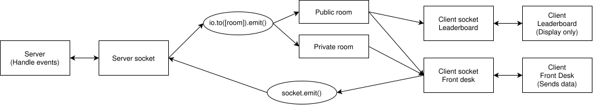

# Connections

How the frontend and the server talk to each other.

## HTTP endpoints

### POST /api/login

Checks the access key for the selected station.

**Status:** in progress (only logs the request for now)

**Request body** (JSON):

| Field       | Type   | Required | Description                                                                       |
| ----------- | ------ | -------- | --------------------------------------------------------------------------------- |
| `station`   | string | yes      | Which station to log in to: `/front-desk`, `/race-control` or `/lap-line-tracker` |
| `accessKey` | string | yes      | The key typed by the employee                                                     |

Example:

```json
{
	"station": "/race-control",
	"accessKey": "test"
}
```

**Responses:**

| Status   | When           |
| -------- | -------------- |
| `200 OK` | Key is correct |

| `401 Unauthorized` | Key is wrong (answered after a 500 ms delay) |
| `400 Bad Request` | `station` or `accessKey` is missing |

**Used by:** `frontend/src/components/LoginForm.jsx`
**After a successful login:** the frontend calls `establishConnection()` (Socket.IO, see below).

## Sockets

### Opening sockets

The frontend creates a client socket when a station is opened by a client.  
(`frontend/src/socket.js -> export socket`)  

After successful authentication, the client socket opens a connection to the server.  
(`frontend/src/socket.js -> establishConnection`)  

Client sockets are then configured on the server to correspond to their own stations and join rooms (see below).  
(`backend/socket/events.js -> setupConnection`)

### Rooms

Socket.io uses rooms to communicate changes from the server to clients.

| Room   | Client type   |
| -------- | -------------- |
| `Public` | All clients |
| `Private` | `/front-desk`<br>`/race-control`<br>`/lap-line-tracker` |

### Events


