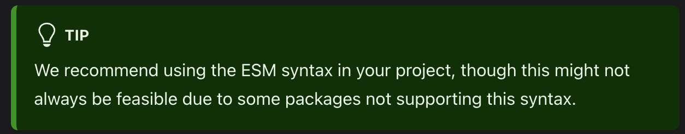

### ES modules instead of CommonJS

- **Question:** Should the backend use `require` (CommonJS) or `import` (ES modules)?
- **Decision:** ES modules (`"type": "module"` in package.json).
- **Why:** It is the official JavaScript standard, and Vite and React already use it, so frontend and backend code look the same. Also socket.io tutorial recommended it:
  
- **Alternatives:** CommonJS, the default at the start. Rejected because it is Node's older format.
- **Consequences:** use `import`, add `.js` to own file imports, use `import.meta.dirname` instead of `__dirname`.

### Javascript instead of Typescript

- **Question:** Should we use Typescript which is better that Javascript?
- **Decision:** Javascript
- **Why:** I don't know, but we've been using Javascript now so I kept it that way.
- **Alternatives:** TypeScript, it adds static types to JavaScript, which helps catch errors before the code runs.

### Biome for formatting and linting

- **Question:** How do we keep our code formatted and free of common mistakes?
- **Decision:** Biome (formatter + linter), run automatically before each commit with lefthook.
- **Why:**
  - It formats our JavaScript automatically on every commit, so both of us write in the same style.
  - It is strict: it catches mistakes (e.g. using `var` instead of `let`) and blocks the commit until they are fixed, so nothing careless ends up in the repository by accident.
  - It teaches us good habits while we are learning.
  - Its rules can be adjusted if something becomes a problem.

### React + Vite for the frontend

- **Question:** How do we build the frontend for the seven interfaces?
- **Decision:** React
- **Why:**
  - We wanted to learn React, which is the most popular framework in the world!
  - The seven interfaces share parts (e.g. the fullscreen button, the login form). React components let us build a part once and reuse it.
- **Alternatives:** Plain HTML, CSS and JavaScript served by Express. Rejected because shared parts would have to be copied to every page.

### Vite as the build tool for React

- **Question:** React code (JSX) must be converted before the browser can run it. Express only sends files, it cannot convert them solely. Which tool do we use?
- **Decision:** Vite
- **Why:**
  - It is the setup React itself recommends for starting a project.
  - It updates the browser instantly when a file is saved (HMR).
  - It needs almost no configuration.
- **Alternatives:**
  - Create React App: no longer maintained.
  - Webpack: works, but needs a lot of manual configuration.
  - Next.js: has its own server, which would overlap with Express.
- **Consequences:** the frontend has its own `package.json`, and `npm start` must serve the built frontend (`vite build`).

### Login on the home page with a station selection

- **Question:** How does an employee choose which interface to log in to?
- **Decision:** The home page has a station selection (Front Desk, Race Control, Lap-line Tracker) and one access key field. The selected station decides which key the field is checked against. Front Desk is selected by default.
- **Why:**
  - No unnecessary login popups or changing pages for each choise
  - Chose to use radiobuttons, cos it unables to choose only one selection
- **Alternatives:** A separate login form on each interface's own page (e.g. `/race-control`).
- **Consequences:**
  - The selection must be sent to the server together with the key, so the server knows which key to compare against.
  - Open question: what happens when someone opens `/race-control` directly without logging in? It must be blocked somehow.

  ### How the frontend reaches the server in development

- **Question:** In development, Vite (port 5173) and Express (port 3000) run separately. How does the frontend send requests to Express?
- **Decision:** Vite proxy: requests starting with `/api` are forwarded to Express.
- **Why:**
  - The frontend code always uses the same address (`/api/login`), both in development and in production.
  - No CORS setup is needed for Express, because the browser only talks to one port.
- **Alternatives:** Call Express directly (`http://localhost:3000/api/login`) and allow it with CORS. Not chosen because <your reason>, and the address would have to be changed for production.
- **Consequences:**
  - In development, both servers must be running.
  - Vite must be restarted after changing `vite.config.js`.
  - The proxy only exists in development. `npm start` must serve the built frontend from Express (not done yet).
  - REMEMBER TO TELL JOONATAN IF SOCKET CONNECTION IS ALSO DONE THROUGH PROXY

### npm workspaces (monorepo) for backend and frontend

- **Question:** The backend (Express) and the frontend (Vite + React) have their own `package.json` files. The reviewer runs `npm install` and `npm start` in the project root. How do they get the frontend installed and built without extra steps?
- **Decision:** npm workspaces. The root `package.json` lists `"workspaces": ["frontend"]`. One `npm install` in the root installs both packages, and a `prestart` script builds the frontend before `npm start`.
- **Why:**
  - The reviewer only needs `npm install` and `npm start`. There are no extra steps to read or forget.
  - One `package-lock.json` in the root, so both of us have the same package versions.
  - The build runs on every `npm start`, so the served frontend is never out of date.
- **Alternatives:**
  - **README instructions.** Install and build the frontend manually before `npm start`. Rejected: if the reviewer skips a step, nothing works.
- **Consequences:**
  - `frontend/package-lock.json` is removed. The root lock file is the only one.
  - Frontend packages are installed from the root with `-w frontend` (e.g. `npm install react-router -w frontend`). Without `-w frontend`, the package goes into the root `package.json`.
  - After `git pull`, run `npm install` in the root.
